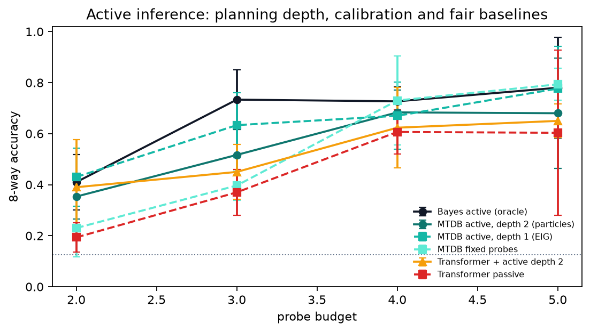
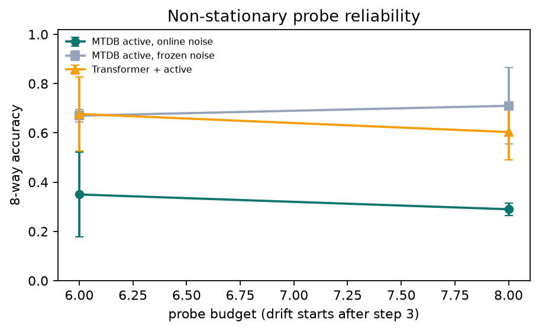

# Active Inference — "thinking" beyond next-token prediction (v0.3)

> **Status: scoped research prototype. Not AGI, and not a universal claim that
> "MTDB beats Transformers".** This document reports a controlled active-sensing
> benchmark with fair baselines, multiple seeds, confidence intervals and
> deliberately visible negative results.



## 1. What changed in v0.3

Building on the v0.2 one-step expected-information-gain (EIG) planner:

| Upgrade | Status | Finding |
|---|---|---|
| Multi-step / particle planning (depth 2) | implemented | **negative on this task** — one-step EIG is better at budgets 2–5 |
| Online probe-reliability adaptation under label-free drift | implemented | **negative** — naive posterior-weighted noise estimates saturate and hurt |
| Temperature calibration + split conformal sets | implemented | **positive on calibration metrics**; ECE down, conformal coverage ≈ 0.90 |
| Fair "Transformer + active policy" baseline | implemented | MTDB one-step active still ahead at budgets 2–5, but gap is modest |
| Multi-seed (3) + 95% CIs | implemented | all tables/plots report mean ± 95% CI |
| Real event-camera/audio/robot validation | **not done** | requires sensor data and an action loop; see §7 |

The important result is not "we beat Transformers"; it is that **active evidence
acquisition, implemented on a learned world model, buys sample efficiency at
small probe budgets**, and that this can be measured against fair baselines.

## 2. Protocol

- **Task**: 8 hidden classes encoded by 3 bits; 8 binary probes with 10% label
  noise; two probes are redundant; 3 well-chosen probes identify the class.
- **Training**: 600 random-probe episodes, 80/20 fit/calibration split; MTDB is
  trained with local/ridge readouts (no backprop), the Transformer baseline with
  backprop on exactly the same episodes.
- **Evaluation**: 100 fresh episodes per budget, **3 seeds**, 95% CI
  (t-distribution; 2 degrees of freedom).
- **Models**: MTDB (69,216 params) vs causal Transformer (69,832 params).
- **Shared planner**: both active-policy variants use the same probe table
  learned from labelled training data and the same expected-free-energy planner;
  only the class posterior differs.
- **Budgets**: 2, 3, 4, 5 probes.
- **Multi-step**: depth-2 particle planning with 12 particles and greedy
  continuation.
- **Calibration**: temperature scaling on held-out calibration episodes +
  split-conformal prediction sets at α = 0.1.

## 3. Stationary results (mean ± 95% CI over 3 seeds)

| Budget | MTDB active d1 | MTDB active d2 | MTDB fixed | Transformer passive | Transformer + active d2 | Bayes oracle |
|---:|---:|---:|---:|---:|---:|---:|
| 2 | **0.430 ± 0.114** | 0.353 ± 0.087 | 0.230 ± 0.114 | 0.193 ± 0.057 | 0.390 ± 0.188 | 0.410 ± 0.108 |
| 3 | **0.633 ± 0.127** | 0.517 ± 0.127 | 0.397 ± 0.057 | 0.370 ± 0.090 | 0.450 ± 0.108 | 0.733 ± 0.117 |
| 4 | 0.670 ± 0.131 | 0.683 ± 0.087 | **0.730 ± 0.174** | 0.607 ± 0.087 | 0.623 ± 0.158 | 0.727 ± 0.057 |
| 5 | 0.777 ± 0.165 | 0.680 ± 0.217 | **0.793 ± 0.063** | 0.603 ± 0.324 | 0.650 ± 0.066 | 0.780 ± 0.197 |

Chance = 0.125.

### Reading the table

- **At small budgets (2–3 probes), active EIG planning helps a lot** vs. the
  same MTDB with fixed probes and vs. a passive Transformer: 0.633 vs 0.397 /
  0.370 at 3 probes.
- **At larger budgets (4–5), a fixed probe order catches up**: with enough
  probes, redundancy no longer matters. Active inference is primarily a
  *sample-efficiency* tool, not a free accuracy boost.
- **Multi-step particle planning (d2) did not help** at 2–3 probes and was
  roughly tied at 4; the one-step greedy planner is the better default here.
  This is a negative result, not a hidden success.
- **Fair baseline**: when the Transformer is given the *same active planner*
  (d2) and the same learned probe table, it reaches 0.390 / 0.450 / 0.623 /
  0.650. MTDB d1 is still ahead at every budget, but the gap is modest at 4–5
  probes, so the evidence does not support a blanket architecture claim.
- **Oracle gap**: exact Bayes active reaches 0.733 at 3 probes vs MTDB 0.633.
  The remaining gap is dominated by the finite-data readout/uncertainty model.

## 4. Calibration (mean over 3 seeds)

| Metric | Before temperature scaling | After temperature + conformal |
|---|---:|---:|
| ECE (10 bins) | 0.548 | **0.503** |
| NLL | 1.852 | **1.649** |
| Conformal coverage (target 0.90) | — | **0.903** |
| Average prediction-set size | — | 1.96 |

Calibration improves NLL/ECE and conformal coverage is close to the nominal
level, but **ECE remains high** (~0.5) because the linear ensemble itself is
under-expressive/over-confident for some classes. This is a concrete headroom
item: better last-layer uncertainty (e.g. Bayesian last layer, deep ensembles
with diverse features, or nonlinear calibration) is needed before the gap to
the Bayes oracle can be closed.

## 5. Negative result: label-free online probe adaptation

We added per-probe reliability updates: after each observation the agent updates
`noise[q]` with the posterior-expected mismatch. Under a mid-episode drift where
probes 0–3 become unreliable (noise 0.4 after step 3), the update **saturates all
probe-noise estimates** and degrades planning:

| Budget (drift at step 3) | Frozen reliability | Online adaptive noise | Transformer + active |
|---:|---:|---:|---:|
| 6 | **0.670** | 0.350 | 0.677 |
| 8 | **0.710** | 0.290 | 0.603 |

Diagnosis: the class posterior used to compute expected mismatches is itself the
thing that degrades under drift, so the adaptation reinforces its own error and
drives every probe to the noise cap. We keep this experiment in the repository
because it is an honest boundary: **label-free probe adaptation is not solved**
by posterior-weighted noise updates. Next step: semi-supervised adaptation
(occasional labels / known probe semantics) or a separate probe-reliability
model with its own excitation.



## 6. What is actually in the code

- `mtdb/active/planning.py` — belief-space one-step EIG and particle/multi-step
  planning, probe-table inference.
- `mtdb/active/agent.py` — `ActiveSensingAgent`:
  - class/outcome bootstrap-ridge ensembles (no backprop in the base/readouts);
  - temperature scaling, split-conformal prediction sets, calibration report;
  - depth-1/depth-2 planning, optional online probe-noise adaptation;
  - optional sensory evidence trace through the MTDB interface.
- `MTDBSystem.snapshot_state()` / `restore_state()` — mental-rollout snapshots
  (including working-memory usage) with bit-exact restoration tests.
- `mtdb/baselines/transformer.py` — parameter-matched causal Transformer baseline
  with causal Transformer encoder, trained by backprop.
- `scripts/active_benchmark.py` — 3-seed benchmark, calibration, drift, two plots.
- `results/active_v03/results.json` — per-seed and aggregate data.
- `results/active_v02/results.json` — v0.2 one-step benchmark for comparison.

## 7. Real event-camera / audio / robot validation (not done)

This iteration does **not** claim real-sensor validation. The benchmark is
synthetic and small. For real active perception, the missing pieces are:

1. a feature front-end for DVS/audio/touch/proprioception;
2. an environment/action loop where the agent's queries are real sensor
   actions (gaze, touch, audio probe) rather than table labels;
3. a probe-semantics model that is learned online, not supplied by a synthetic
   test matrix.

The existing [`mtdb/tasks/array.py`](mtdb/tasks/array.py) adapter can already
ingest arbitrary `[N, T, F]` feature streams for the v0.1 prediction pipeline.
The active-inference task needs an additional environment wrapper; no real-data
numbers are reported until that exists.

## 8. Reproduce

```bash
python scripts/active_benchmark.py       # ~70 s CPU, 3 seeds
python -m pytest tests -q                 # 35 tests
```

The script writes `artifacts/active_v03/results.json` by default and refreshes
the two figures in `assets/`. The committed copy is
[`results/active_v03/results.json`](results/active_v03/results.json).

## 9. Honest takeaway

- **Positive, scoped**: active EIG planning improves sample efficiency at small
  probe budgets; calibration/conformal uncertainty works reasonably; a fair
  Transformer + active-policy baseline is included and MTDB remains competitive
  to slightly ahead.
- **Negative, reported**: multi-step particle planning and label-free online
  probe adaptation are not solved and hurt on this benchmark.
- **Not claimed**: universal Transformer superiority, AGI, or real-sensor
  validation. Any of those claims would require much stronger and broader
  evidence than this synthetic task can provide.

The next useful experiments are: a **semi-supervised drift protocol** with
occasional labels, a **Bayesian last layer** to shrink the oracle gap, **multi-step
planning with a calibrated model**, and a real sensor/action loop.
