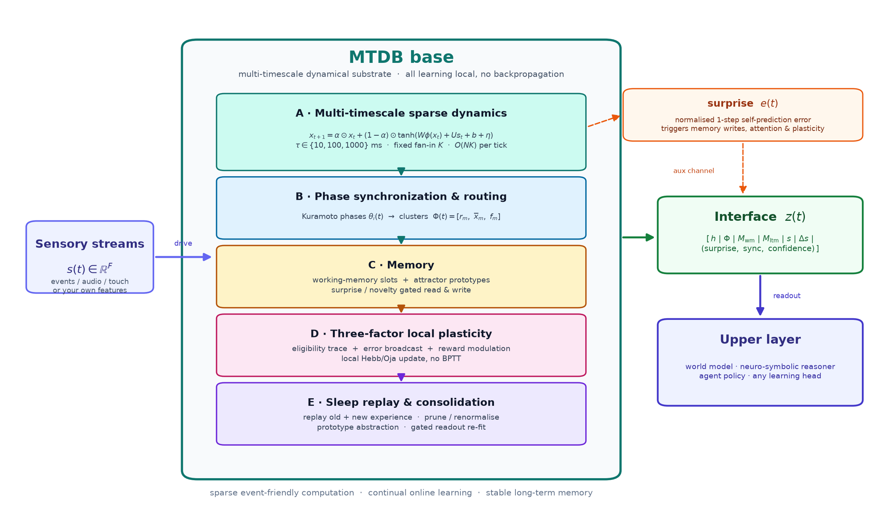
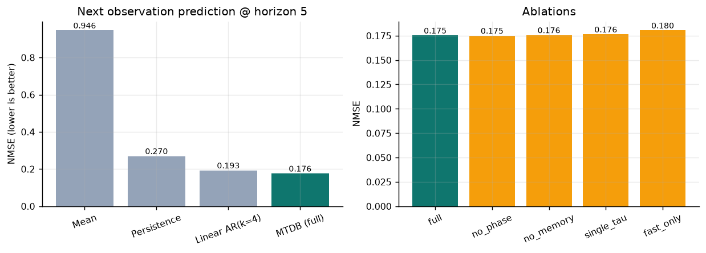
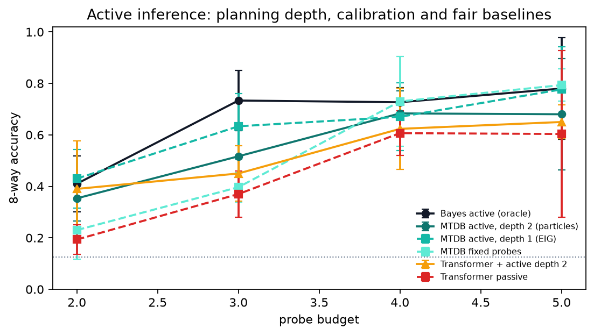
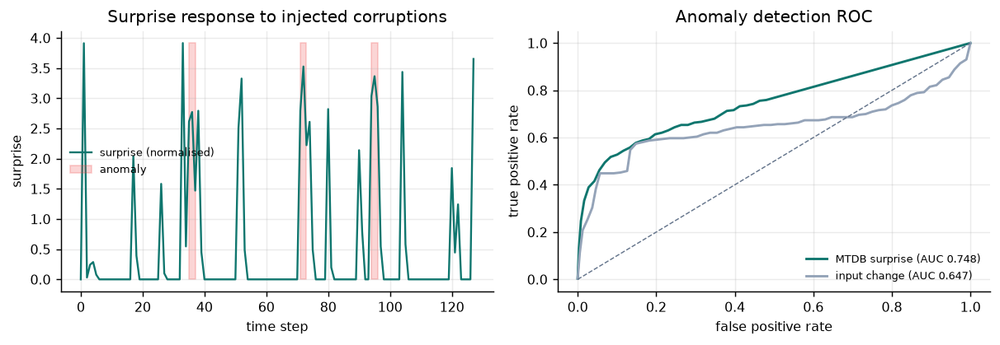
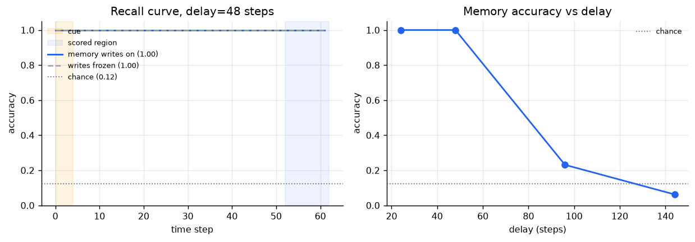
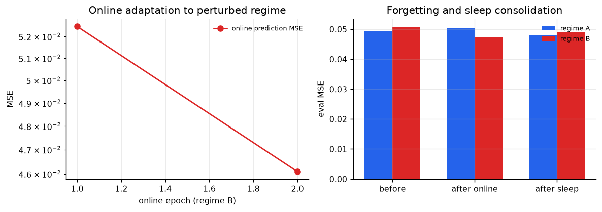
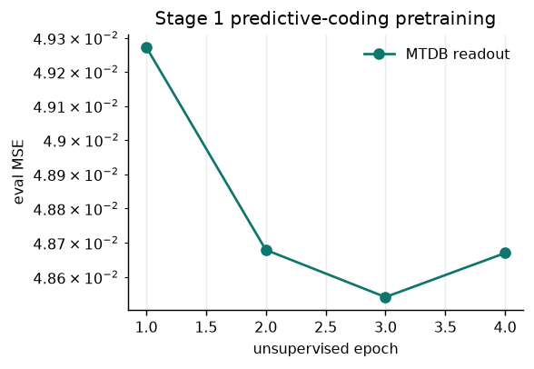

# MTDB — Multi-Timescale Dynamical Base

**English** | [中文](README.zh-CN.md)

[](https://github.com/cndichengyu/mtdb/actions/workflows/ci.yml)
[](https://github.com/cndichengyu/mtdb)
[](https://pytorch.org)
[](LICENSE)
[](RESULTS.md)

A **non-Transformer training substrate** for the sensorimotor–intuition–memory layer
of hybrid AGI systems: sparse multi-timescale dynamics, Kuramoto phase routing,
working/attractor memory, three-factor local plasticity, sleep-replay consolidation,
and a compressed interface for upper-layer world models.



> **Status: research prototype. Not AGI, and not a drop-in Transformer replacement.**
> MTDB implements the bottom layer of a hybrid architecture — perception compression,
> temporal dynamics, online adaptation, prediction-error (surprise) signals and stable
> long-term memory. Language, logic and planning still belong to upper-layer world
> models / neuro-symbolic reasoners / agents. All experiments here are small-scale
> synthetic probes; they are evidence, not an AGI claim.

---

## Why this exists

Transformers are excellent sequence models, but the bottom of an embodied, continually
learning system needs different properties:

- **Energy & sparsity** — computation on sparse, local connections instead of dense
  quadratic attention.
- **Continuous time** — state that evolves across multiple time constants, not only
  discrete token positions.
- **Online adaptation** — learning during inference without a global backward pass.
- **Stable memory** — surprise-gated writes and attractor retrieval instead of an
  ever-growing context window.
- **Grounding** — a sensorimotor feature stream and phase-based binding as first-class
  citizens.

MTDB is a concrete, runnable attempt at that layer. It is intentionally small enough
to train on a laptop CPU, so the architecture can be tested and falsified quickly.

---

## 30-second results

CPU-only, `configs/standard.yaml` (2,048 units, 257k parameters, ~4 min):

| Probe | MTDB | Strongest non-Transformer baseline | Notes |
|---|---|---|---|
| Next observation, horizon=5 | **MSE 0.0486** | persistence 0.0744; linear-AR(4) 0.0532 | 8.7% lower MSE than linear-AR |
| Anomaly detection | **ROC-AUC 0.722** | input-change 0.647 | 3-step smoothing: 0.748 vs 0.745 (tie) |
| Delayed recall, 8 classes | **1.000** @ delay 48 | chance 0.125 | delay 96: 0.231 (with memory writes) vs 0.134 (frozen) |
| Online adaptation, regime B | **−6.9% MSE** | — | regime A degrades only 1.7% |
| Forgetting stress + sleep replay | **A: 0.0495 → 0.1147 → 0.0481** | — | replay recovers almost all forgetting |



Full tables, curves, ablations and caveats: **[RESULTS_EN.md](RESULTS_EN.md)** ·
[中文版](RESULTS.md).

---

## v0.2: active inference — the model chooses what to observe

v0.2 adds a real deliberation loop: before acting, the model **simulates the
consequences of candidate probes and picks the most informative one** (expected
free energy), instead of passively predicting the next observation. On an
8-class active-sensing task with redundant noisy probes, this planning turns into
a measurable sample-efficiency gain over both the same MTDB base with fixed
probes and a parameter-matched causal Transformer trained on the same episodes:

| Probe budget | **MTDB active** | MTDB fixed | Transformer passive | Transformer + MTDB probes | Bayes active (oracle) |
|---:|---:|---:|---:|---:|---:|
| 3 | **0.605** | 0.430 | 0.315 | 0.495 | 0.765 |
| 4 | **0.750** | 0.680 | 0.525 | 0.700 | 0.725 |
| 5 | **0.825** | 0.820 | 0.555 | 0.725 | 0.810 |



Honest reading: most of the advantage comes from **active evidence acquisition**
(the Transformer improves a lot when given the same chosen observations), and
there is still a gap to the exact Bayesian oracle. This is a scoped synthetic
benchmark, not a universal Transformer-beating or AGI claim. Full protocol,
numbers and limitations: **[ACTIVE_INFERENCE.md](ACTIVE_INFERENCE.md)**.

```bash
# ~8 s on CPU
python scripts/active_benchmark.py
```

---

## What is inside

| Layer | Code | What it does |
|---|---|---|
| **A. Multi-timescale dynamics** | [`mtdb/core/dynamics.py`](mtdb/core/dynamics.py) | Sparse fan-in recurrent core; τ ∈ {10, 100, 1000} ms; exponential-Euler discretisation; spectral-radius init; homeostatic bias |
| **B. Phase synchronization** | [`mtdb/core/phase.py`](mtdb/core/phase.py) | Kuramoto phases, synchronization-cluster features `[r, mean x, fraction]`, cluster membership for binding/routing |
| **C. Memory** | [`mtdb/core/memory.py`](mtdb/core/memory.py) | Content-addressed working-memory slots; top-k attractor prototypes; surprise/novelty-gated writes |
| **D. Local plasticity** | [`mtdb/core/plasticity.py`](mtdb/core/plasticity.py) | Eligibility/STDP trace + error broadcast + reward modulation + Oja/row-norm stability, **no BPTT** |
| **E. Sleep replay** | [`mtdb/core/consolidation.py`](mtdb/core/consolidation.py) | Regime-balanced replay, prototype abstraction, prune/renormalise, gated readout re-fit |
| **Interface** | [`mtdb/core/interface.py`](mtdb/core/interface.py) | Explicit, addressable `z(t)` packet for upper layers |
| **Readouts** | [`mtdb/training/readout.py`](mtdb/training/readout.py) | Closed-form ridge and online RLS with Bayesian precision init — **no backprop** |
| **Training pipeline** | [`mtdb/training/trainer.py`](mtdb/training/trainer.py) | 3-stage training + forgetting stress test + ablations + delayed recall |
| **Custom data** | [`mtdb/tasks/array.py`](mtdb/tasks/array.py) | Convert your own `[N, T, F]` feature streams into trainer-ready sequences |
| **Active inference (v0.2)** | [`mtdb/active/`](mtdb/active/) | Expected-free-energy planning over probes; belief-space consequence simulation (+ latent-rollout fallback); active-sensing benchmark |
| **Transformer baseline** | [`mtdb/baselines/transformer.py`](mtdb/baselines/transformer.py) | Small causal Transformer used only for fair active-sensing comparisons |
| **Synthetic worlds** | [`mtdb/tasks/synthetic.py`](mtdb/tasks/synthetic.py) | Multimodal prediction/anomaly world and delayed-recall world |

The base itself never uses backpropagation. Only the upper readout is fitted, by
least squares / recursive least squares.

---

## Interface `z(t)`

With the standard preset, the 283-dimensional packet is:

| Slice | Dim | Meaning |
|---|---|---|
| `h` | 128 | compressed multi-timescale latent state |
| `phase` | 36 | 12 synchronization clusters × `[coherence, mean state, fraction]` |
| `wm` | 48 | working-memory readout |
| `attractor` | 48 | long-term attractor retrieval |
| `input` / `delta` | 10 + 10 | current observation and its first difference |
| `trace` (optional) | F | decaying sensory evidence trace, enabled by `include_sensory_trace=True` |
| `aux` | 3 | `(surprise, sync, confidence)` |

Consume it in any upper layer:

```python
out = system.step(sensor_features)      # sensor_features: [F] tensor
z = out.packet.z                         # [283]
surprise = out.packet.surprise           # scalar, for attention / exploration / writes
```

---

## Quick start

```bash
git clone https://github.com/cndichengyu/mtdb.git
cd mtdb

# Python 3.10+; a venv with CPU PyTorch is enough
python -m venv .venv
source .venv/bin/activate
pip install -e ".[dev]"

# 1-minute synthetic probe (768 units)
python scripts/train.py --config configs/debug.yaml

# standard probe (2,048 units, CPU ~4 min)
python scripts/train.py --config configs/standard.yaml --run-name demo_standard

# tests
pytest tests -q
```

Artifacts are written to `artifacts/<run_name>/`: `results.json`, `checkpoint.pt`,
`checkpoint_stage1.pt`, resolved config and five figures.

---

## Train on your own data

The base only needs a feature stream. Prepare an `.npz` file with:

```python
# data/my_stream.npz
#   train: [N, T, F]   training stream
#   eval:  [N, T, F]   held-out stream
# optional:
#   train_b / eval_b:                 second regime for the online experiment
#   eval_anomaly: [N, T, F]           stream with injected anomalies
#   eval_anomaly_mask: [N, T] bool    anomaly labels
```

Then:

```bash
python scripts/train.py --config configs/standard.yaml --data data/my_stream.npz
```

Features are z-scored using training-split statistics only; targets are derived as
`x[t + horizon]`. The input dimension is inferred automatically. For sleep replay,
make sequences at least `consolidation.window_len` ticks long (96 in `debug`, 128 in
`standard`), or lower that config value. You can also call the API directly:

```python
from mtdb.config import ExperimentConfig
from mtdb.tasks.array import make_streams_from_arrays
from mtdb.training.trainer import MTDBTrainer

streams, meta = make_streams_from_arrays(
    train=my_train_array,          # [N, T, F]
    eval=my_eval_array,            # [N, T, F]
    horizon=5,
    normalize=True,
)
cfg = ExperimentConfig.from_yaml("configs/standard.yaml")
trainer = MTDBTrainer(cfg, streams=streams)
results = trainer.run()
```

For a complete runnable example see [`examples/custom_stream.py`](examples/custom_stream.py).

---

## How training works

1. **Unsupervised predictive-coding pretraining** — drive the base with sensor
   streams; update only self-prediction / homeostasis locally; fit the upper readout
   with ridge least squares.
2. **Online task learning** — initialize RLS from the stage-1 posterior, adapt the
   readout tick-by-tick, and optionally update recurrent weights with three-factor
   local plasticity; surprise-gated memory writes happen during inference.
3. **Sleep replay consolidation** — replay old + new experience, abstract attractor
   prototypes, prune/renormalise synapses, and re-fit the readout only when replay
   error improves.

Two built-in diagnostics make the claims checkable: an **aggressive-forgetting stress
test** (`forget=0.999` followed by sleep replay) and component **ablations**
(`full / no_phase / no_memory / single_tau / fast_only`).

---

## Presets and scaling

| Preset | Units | Fan-in | Interface | Params | Runtime (CPU) |
|---|---:|---:|---:|---:|---:|
| `configs/debug.yaml` | 768 | 16 | 207 | 95k | ~1 min |
| `configs/standard.yaml` | 2048 | 24 | 283 | 257k | ~4 min |
| `configs/mvp.yaml` | 16384 | 32 | 435 | ~2M | not run in CI |

The core step is O(N·K) with sparse gathers. The current code is a discrete-tick
approximation of an event-driven substrate; hardware mapping (neuromorphic / in-memory
computing) is a design target, not a measured result.

---

## Results gallery

| | |
|---|---|
|  |  |
| surprise response & anomaly ROC | delayed-recall accuracy vs delay |
|  |  |
| online adaptation & sleep recovery | stage-1 predictive-coding curve |

---

## Honest limitations

- Synthetic 10-D world only; not validated on real vision/audio/robotics yet.
- Phase and memory ablations are **small** on short-horizon prediction; the clearest
  evidence for slow timescales is the delayed-recall curve and the `fast_only` ablation.
- Working memory only shows a clear advantage at long delays (96 steps: 0.231 vs 0.134).
- Sleep consolidation currently lives mostly in the readout; recurrent synapses are
  pruned/renormalised but not replayed with STDP.
- No language/reasoning/planning; no hardware power/latency measurements.
- Anomaly detection should use `checkpoint_stage1.pt`; online adaptation changes the
  surprise normalisation statistics (documented in the results).
- The v0.2 active benchmark is a synthetic 8-class task; the advantage comes
  mostly from active evidence acquisition, and a Transformer given the same
  chosen observations closes much of the gap. No universal superiority claim.

See [`ARCHITECTURE_EN.md`](ARCHITECTURE_EN.md) §9 for the full risk list.

---

## Roadmap

0. **Done in v0.2**: active-inference loop (probe selection by expected free energy).
   Next: multi-step particle planning, online probe-table adaptation, calibrated
   uncertainty, real active-perception streams.
1. Event-driven / spiking kernels instead of dense ticks.
2. Close the loop: phase clusters select modules/memory slots/gains.
3. Trajectory-level STDP replay (not only readout re-fitting).
4. Hierarchical MTDB connected to a world model / SSM / neuro-symbolic reasoner.
5. Real multimodal front-ends: event cameras, audio, touch/proprioception.
6. 10⁴–10⁵ units with measured power, latency and throughput.

---

## Repository layout

```text
mtdb/
├── core/          # dynamics, phase, memory, plasticity, consolidation, interface
├── training/      # ridge/RLS readouts + 3-stage trainer
├── tasks/         # synthetic worlds + custom-array adapter
├── active/        # v0.2 active inference: environment, agent, planning
├── eval/          # metrics and figures
├── baselines/     # persistence / mean / linear-AR / small Transformer
configs/           # debug / standard / mvp presets
scripts/           # train.py / eval.py / active_benchmark.py
examples/          # custom stream example
tests/             # unit + integration tests (CI)
assets/            # architecture and result figures
results/           # committed JSON results (base demos + active v0.2)
```

---

## Testing and CI

```bash
pytest tests -q
ruff check mtdb scripts tests --select F401,F841,F821,E9
```

CI runs the test suite, a 1-epoch smoke train, and a quick active-inference
benchmark on every push and pull request.

---

## Citation

```bibtex
@misc{mtdb2026,
  title        = {MTDB: Multi-Timescale Dynamical Base},
  author       = {cndichengyu},
  year         = {2026},
  howpublished = {\url{https://github.com/cndichengyu/mtdb}},
  note         = {A non-Transformer training substrate for hybrid AGI prototypes}
}
```

Citation metadata is also in [`CITATION.cff`](CITATION.cff). MIT licensed.

---

## Contributing

This is an early research prototype; reproducible experiments, negative results and
clearly scoped extensions are all welcome. See [`CONTRIBUTING.md`](CONTRIBUTING.md)
and open an issue with your config/`results.json` if you find something interesting.

If this direction is useful to you, a ⭐ helps other researchers find the project.
