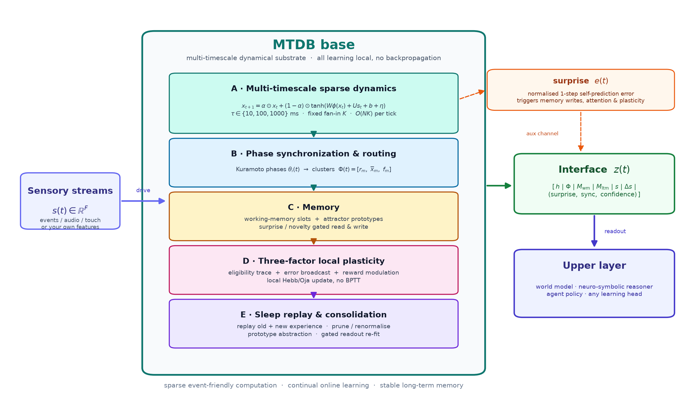
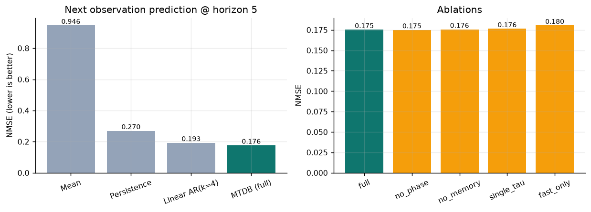
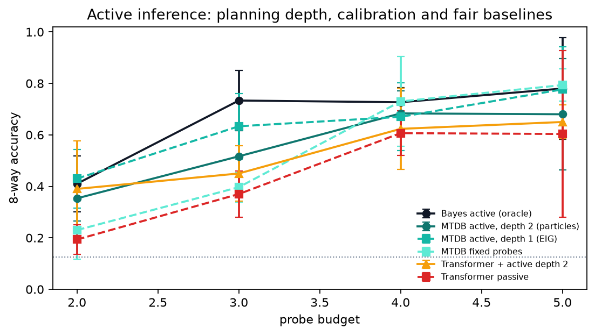

# MTDB — 多时间尺度动力学基底

[English](README.md) | **中文**

[](https://github.com/cndichengyu/mtdb/actions/workflows/ci.yml)
[](https://github.com/cndichengyu/mtdb)
[](https://pytorch.org)
[](LICENSE)

面向混合 AGI 系统“感知—直觉—记忆基底”的**非 Transformer 训练底座**：
稀疏多时间尺度动力学 + Kuramoto 相位同步 + 工作/吸引子记忆 + 三因子局部可塑性 +
睡眠回放巩固 + 面向上层世界模型的压缩接口 `z(t)`。



> **研究原型，不是 AGI，也不是 Transformer 替代品。** MTDB 只实现混合架构的底层：
> 感知压缩、时间动态、在线适应、预测误差（surprise）和稳定长期记忆。语言、逻辑、
> 规划仍属于上层世界模型 / 神经符号 / 智能体。当前实验全部是合成小规模验证。

---

## 为什么做这个

具身、持续学习的系统需要与 Transformer 不同的底层性质：

- **能效与稀疏**：局部稀疏连接，而非稠密平方复杂度注意力；
- **连续时间**：多时间尺度状态承载动态，而不只是 token 位置；
- **在线适应**：推理时持续学习，不需要全局反向传播；
- **稳定记忆**：惊奇门控写入 + 吸引子检索，而不是无限增长上下文；
- **具身 grounding**：传感器流与相位绑定是一等公民。

这个仓库把上述想法做成**可在笔记本 CPU 上训练、可复现、可证伪**的代码。

---

## 30 秒结果

`configs/standard.yaml`，2,048 单元、25.7 万参数、CPU 约 4 分钟：

| 任务 | MTDB | 最强非 Transformer 基线 | 说明 |
|---|---|---|---|
| 下一观测预测（horizon=5） | **MSE 0.0486** | persistence 0.0744；linear-AR(4) 0.0532 | 比 linear-AR 低 8.7% |
| 异常检测 | **ROC-AUC 0.722** | 输入变化 0.647 | 3 步平滑后 0.748 vs 0.745（打平） |
| 延迟回忆（8 类） | **1.000** @ delay 48 | chance 0.125 | delay 96：0.231（开写入）vs 0.134（冻结） |
| 在线适应 regime B | **MSE −6.9%** | — | regime A 仅退化 1.7% |
| 遗忘压力测试 + 睡眠回放 | **A: 0.0495 → 0.1147 → 0.0481** | — | 回放几乎完全恢复遗忘 |



完整表格、曲线、消融与局限见 **[RESULTS.md](RESULTS.md)**（[English](RESULTS_EN.md)）。

---

## v0.2：主动推理——模型自己决定"看什么"

v0.2 在底座之上加入真正的 deliberation 循环：行动之前**模拟每个候选探针的两种
可能结果，按期望后验熵（expected free energy）选择最有信息量的探针**，而不是被动
预测下一个观测。在"8 类 + 冗余含噪探针"的主动感知任务上，主动规划带来可测量的
样本效率提升（同参数量 Transformer 基线用同一批训练数据）：

| 探针预算 | **MTDB 主动** | MTDB 固定 | Transformer 被动 | Transformer+主动探针 | 贝叶斯主动（上界） |
|---:|---:|---:|---:|---:|---:|
| 3 | **0.605** | 0.430 | 0.315 | 0.495 | 0.765 |
| 4 | **0.750** | 0.680 | 0.525 | 0.700 | 0.725 |
| 5 | **0.825** | 0.820 | 0.555 | 0.725 | 0.810 |



诚实解读：优势主要来自**主动获取证据**（Transformer 拿到同样的主动观测后会大幅
提升），且距精确贝叶斯上界仍有差距。这是限定范围的合成基准，不是"通用击败
Transformer"、更不是 AGI 声明。完整协议、数字与局限见
**[ACTIVE_INFERENCE.md](ACTIVE_INFERENCE.md)**（英文）。

```bash
# CPU 约 8 秒
python scripts/active_benchmark.py
```

---

## 包含什么

| 模块 | 代码 | 作用 |
|---|---|---|
| A 多时间尺度动力学 | [`mtdb/core/dynamics.py`](mtdb/core/dynamics.py) | 稀疏 fan-in 循环核；τ ∈ {10,100,1000} ms；谱半径初始化；homeostatic bias |
| B 相位同步路由 | [`mtdb/core/phase.py`](mtdb/core/phase.py) | Kuramoto 相位、同步簇特征、簇成员 |
| C 记忆 | [`mtdb/core/memory.py`](mtdb/core/memory.py) | 内容寻址工作记忆 + 吸引子原型；surprise/novelty 门控 |
| D 局部可塑 | [`mtdb/core/plasticity.py`](mtdb/core/plasticity.py) | eligibility + 误差广播 + reward；Oja/行范数稳定，**无 BPTT** |
| E 睡眠回放 | [`mtdb/core/consolidation.py`](mtdb/core/consolidation.py) | regime 配额回放、原型抽象、剪枝/重归一、门控读出重拟合 |
| 接口 | [`mtdb/core/interface.py`](mtdb/core/interface.py) | 可寻址的 `z(t)` 数据包 |
| 读出 | [`mtdb/training/readout.py`](mtdb/training/readout.py) | 闭式 ridge / 在线 RLS（贝叶斯 precision 初始化），**无 backprop** |
| 训练管线 | [`mtdb/training/trainer.py`](mtdb/training/trainer.py) | 三阶段训练 + 遗忘压力测试 + 消融 + 延迟回忆 |
| 自定义数据 | [`mtdb/tasks/array.py`](mtdb/tasks/array.py) | 把自己的 `[N,T,F]` 特征流转成训练序列 |
| 主动推理（v0.2） | [`mtdb/active/`](mtdb/active/) | 期望自由能探针规划、belief-space 结果模拟（+ latent rollout 回退）、主动感知基准 |
| Transformer 基线 | [`mtdb/baselines/transformer.py`](mtdb/baselines/transformer.py) | 仅用于主动感知公平对比的小型 causal Transformer |
| 合成世界 | [`mtdb/tasks/synthetic.py`](mtdb/tasks/synthetic.py) | 多模态预测/异常、延迟回忆任务 |

底座的动力学与记忆**不使用反向传播**，只有上层读出用最小二乘 / RLS 拟合。

---

## 快速开始

```bash
git clone https://github.com/cndichengyu/mtdb.git
cd mtdb
python -m venv .venv
source .venv/bin/activate
pip install -e ".[dev]"

# 快速实验（768 单元，约 1 分钟）
python scripts/train.py --config configs/debug.yaml

# 标准实验（2048 单元，CPU 约 4 分钟）
python scripts/train.py --config configs/standard.yaml --run-name demo_standard

# 单测
pytest tests -q
```

---

## 用自己的数据训练

准备一个 `.npz`（至少包含 `train` / `eval`，形状 `[N, T, F]`）：

```python
# 可选：
# train_b / eval_b             第二个 regime（在线适应实验）
# eval_anomaly                带异常的评估流
# eval_anomaly_mask           [N, T] bool 异常标签
```

```bash
python scripts/train.py --config configs/standard.yaml --data data/my_stream.npz
```

特征只用训练集统计量做 z-score；目标自动取 `x[t + horizon]`；输入维度自动推断。
注意睡眠回放按整条序列存储：序列长度最好 ≥ `consolidation.window_len`
（debug 96、standard 128），短序列可调小该配置。也可以直接调 API：

```python
from mtdb.config import ExperimentConfig
from mtdb.tasks.array import make_streams_from_arrays
from mtdb.training.trainer import MTDBTrainer

streams, meta = make_streams_from_arrays(my_train, my_eval, horizon=5)
trainer = MTDBTrainer(ExperimentConfig.from_yaml("configs/standard.yaml"), streams=streams)
trainer.run()
```

完整可运行示例：[`examples/custom_stream.py`](examples/custom_stream.py)。

---

## 训练三阶段

1. **无监督预测编码预训练**：驱动底座，只学习自预测/稳态；ridge 拟合读出。
2. **在线任务学习**：RLS 从 stage-1 后验出发逐 tick 适应；可选三因子局部可塑性；
   推理时 surprise 门控写入记忆。
3. **睡眠回放巩固**：回放旧+新经验，抽象原型，剪枝/重归一，回放误差下降时重拟合读出。

内置两类可检验诊断：**激进遗忘压力测试**（sleep 恢复率）与**组件消融**
（`full / no_phase / no_memory / single_tau / fast_only`）。

---

## 配置与规模

| Preset | 单元 | fan-in | 接口 | 参数 | CPU 时间 |
|---|---:|---:|---:|---:|---:|
| `configs/debug.yaml` | 768 | 16 | 207 | 9.5 万 | 约 1 分钟 |
| `configs/standard.yaml` | 2048 | 24 | 283 | 25.7 万 | 约 4 分钟 |
| `configs/mvp.yaml` | 16384 | 32 | 435 | 约 200 万 | CI 不跑 |

核心单步复杂度 O(N·K)，稀疏 gather；当前是离散 tick 近似的事件驱动底座，
硬件功耗/延迟是设计目标，不是实测结果。

---

## 诚实局限

- 仅合成 10 维玩具世界，尚未在真实视觉/音频/机器人数据验证；
- 短时程预测上相位/记忆消融差异很小；慢时间常数的最清楚证据是延迟回忆曲线；
- 工作记忆只在更长延迟（96 步）才明显优于冻结写入；
- 睡眠巩固主要发生在读出层，循环突触只做剪枝/重归一，没有轨迹级 STDP 回放；
- 没有语言/推理/规划，也没有硬件功耗/延迟实测；
- 异常检测应使用 `checkpoint_stage1.pt`（在线适应会改写 surprise 统计）；
- v0.2 主动基准是 8 类合成任务，优势主要来自主动获取证据；Transformer 拿到同样
  主动观测后会追回大部分差距，不构成通用"击败 Transformer"结论。

详见 [ARCHITECTURE.md](ARCHITECTURE.md)（[English](ARCHITECTURE_EN.md)）第 9 节。

---

## 路线图

0. **v0.2 已完成**：主动推理层（按 expected free energy 选择探针）。下一步：
   多步粒子规划、在线探针表适应、不确定性校准、真实主动感知数据；
1. 事件驱动/脉冲 kernel，替代密集 tick；
2. 相位簇闭环选择模块/记忆槽/增益；
3. 轨迹级 STDP 回放；
4. 分层 MTDB 对接世界模型 / SSM / 神经符号推理器；
5. 真实多模态前端（事件相机、音频、触觉/本体感觉）；
6. 10⁴–10⁵ 单元并测量功耗、延迟、吞吐。

---

## 引用与许可

```bibtex
@misc{mtdb2026,
  title        = {MTDB: Multi-Timescale Dynamical Base},
  author       = {cndichengyu},
  year         = {2026},
  howpublished = {\url{https://github.com/cndichengyu/mtdb}}
}
```

MIT License。欢迎 reproducible experiments / 负结果 / 明确边界的扩展；
见 [CONTRIBUTING.md](CONTRIBUTING.md)。

如果这个方向对你有帮助，点一个 ⭐ 能让更多研究者找到它。
