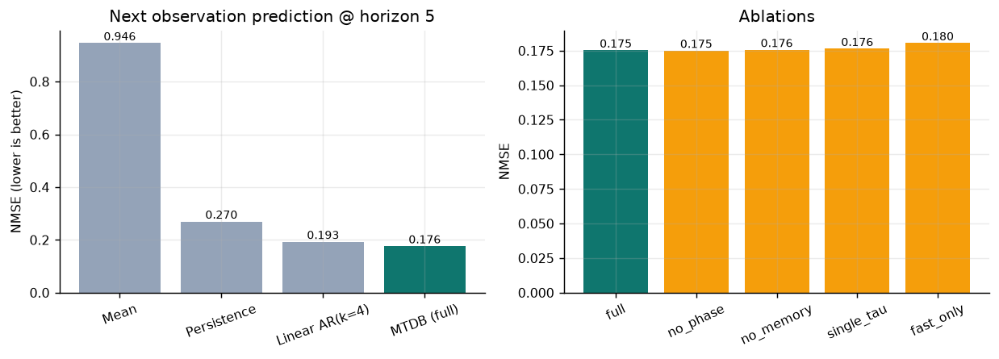
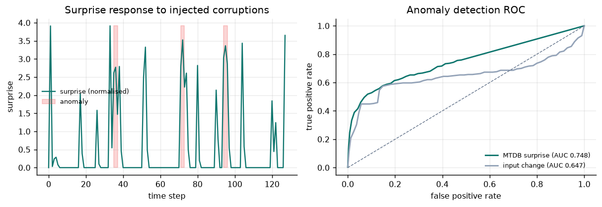
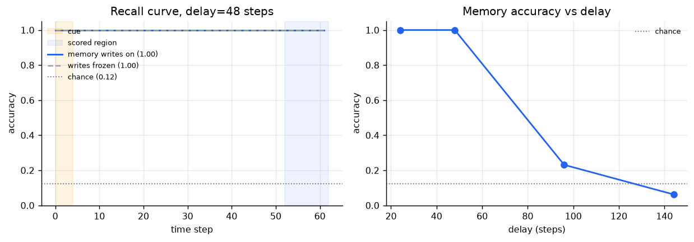
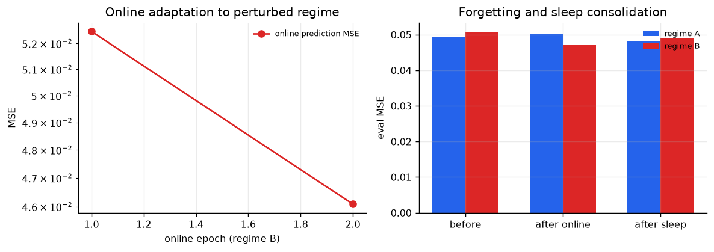

# MTDB 实验结果（v0.1.0）

**中文** | [English](RESULTS_EN.md)

本报告由 `results/demo_standard/results.json`（`configs/standard.yaml`）生成/整理，
命令：

```bash
.venv/bin/python scripts/train.py --config configs/standard.yaml --run-name demo_standard
```

---

## 1. 实验设置

| 项 | 值 |
|---|---|
| 硬件 | Apple Silicon Mac（arm64），CPU（device auto → cpu） |
| 软件 | macOS 27.3 / Python 3.14.6 / PyTorch 2.15.0 / CPU |
| 动力学单元 | N = 2048，fan-in K = 24（约 1.2% 稀疏） |
| 时间常数 | τ = (10, 100, 1000) ms，比例 (0.5, 0.3, 0.2)，dt = 10 ms |
| 相位 | 12 个簇，Kuramoto 耦合 0.4 |
| 记忆 | WM 64 槽，LTM 容量 1024，top-k=12 |
| 接口维度 | 283 = h128 + Φ36 + WM48 + LTM48 + (s,Δs)20 + aux3 |
| 参数量 | 256,896 |
| 数据 | 合成 10 维多模态世界：位置/音频/触觉/物体 one-hot；hidden velocity |
| 预测目标 | horizon = 5 步后的观测 |
| Stage 1 | 4 epochs × 96 条序列 × 128 步 |
| Stage 2 | 2 epochs × 96 条 regime-B 序列，RLS `forget=0.99995` |
| 睡眠 | 2 passes × 256 窗口（每个 regime 配额 128），剪枝 1% |
| 运行时间 | 总计 237.6 s（Stage1 27.7 s + Stage2 49.5 s + 压力测试 33.4 s + 其余） |

---

## 2. 预测：下一观测（horizon=5）



| 模型 | MSE（16 条评估序列均值±std） | NMSE | 相对 MTDB |
|---|---:|---:|---:|
| Mean predictor | 0.26074 ± 0.01388 | 0.946 | +437% |
| Persistence | 0.07436 ± 0.01106 | 0.270 | +53.2% |
| Linear AR(k=4) | 0.05317 ± 0.00659 | 0.193 | +9.5% |
| **MTDB（本仓库）** | **0.04855 ± 0.00615** | **0.176** | — |

- 比 persistence 低 **34.7%**，比 linear-AR(4) 低 **8.7%**；
- 优势来自多时间尺度状态提供的隐藏速度/情境信息（观测里没有速度，只有位置）；
- 这是小规模合成任务，差距不代表真实视觉任务上的比例。

---

## 3. 异常检测：surprise 信号



| 分数 | ROC-AUC | 3 步平滑后 AUC |
|---|---:|---:|
| MTDB normalized surprise | **0.722** | 0.748 |
| 输入变化 \|\|s(t)−s(t−1)\|\| | 0.647 | 0.745 |

- 正常步平均 surprise 0.408，异常步平均 1.864（约 4.6×）；
- 异常类型包括：位置瞬移、音频毛刺、错误物体、位置冻结、音频冻结；
  后两类故意让“输入变化”基线变弱，MTDB 的原始 AUC 优势明显；平滑后两者接近，
  说明输入变化本身对“瞬移/毛刺”类异常已经很强，这是诚实的对照结果；
- 异常步数 303 / 3072（约 9.9%），任务偏难。

---

## 4. 延迟回忆：长时程记忆



8 分类延迟回忆，cue 只呈现 3 步，之后 48 步延迟 + 10 步评测区。  
“writes on/off” 指记忆写入是否在推理时开启（读出与动力学完全冻结）。

| 延迟（步） | 写入开启 | 写入冻结 | chance |
|---:|---:|---:|---:|
| 24 | 1.000 | 1.000 | 0.125 |
| **48（训练延迟）** | **1.000** | **1.000** | 0.125 |
| 96 | **0.231** | 0.134 | 0.125 |
| 144 | 0.063 | 0.063 | 0.125 |

- 训练延迟内准确率 100%，说明慢时间尺度动力学足以承载约 0.5 s 的情境；
- 延迟拉长到 96 步（≈1 s）后准确率骤降，但**写入开启时 0.231 vs 冻结 0.134**，
  工作记忆写入开始体现价值；144 步（≈1.45 s）已低于 chance，说明当前
  最慢 τ=1 s 的记忆基底存在明确时间视界；
- 这个衰减曲线是“底层直觉记忆”的预期行为，也是后续增加更长 τ/吸引子巩固的动机。

---

## 5. 在线适应与睡眠巩固



### 5.1 主实验：保守遗忘（`forget=0.99995`）

| 阶段 | regime A MSE | regime B MSE |
|---|---:|---:|
| 在线前 | 0.04948 | 0.05080 |
| 在线后（2 epochs） | 0.05031 | **0.04730** |
| 睡眠回放后 | **0.04805** | 0.04891 |

- 在线学习让 B 降低 0.00349（−6.9%）；A 仅退化 0.00083（+1.7%）；
- 睡眠回放进一步把 A 恢复到 0.04805（比在线后低 0.00226，也低于在线前），
  说明回放重拟合在“把旧任务拉回来”上是有效的；
- B 在睡眠后轻微回退 0.0016，提示读出重拟合存在旧/新分布折中，被门控限制在
  “回放误差下降”的范围内（replay MSE 0.0543 → 0.0483）。

睡眠统计：回放 256 个窗口、31,488 个样本；吸引子原型 10 个；
剪枝 2,048 个突触；权重漂移 L2=10.94；原型加噪检索 cosine **0.818** vs 随机 chance 0.231。

### 5.2 遗忘压力测试：激进遗忘（`forget=0.999`）

| 阶段 | regime A MSE | regime B MSE |
|---|---:|---:|
| 在线前 | 0.04950 | 0.05084 |
| 在线后（1 epoch） | **0.11474**（遗忘 +0.0652，2.3×） | 0.06761（+33%） |
| 睡眠回放后 | **0.04813**（恢复 0.0666，基本回到在线前） | **0.04902**（恢复 0.0186，回到在线前） |

- 用激进遗忘人为制造“灾难性遗忘”：A 的 MSE 翻倍以上；
- 睡眠回放把 A 拉回 0.04813（甚至略好于在线前），B 也回到 0.04902；
- 回放重拟合前 replay MSE 0.3576 → 后 0.0483，说明读出确实在回放分布上被重建；
- 这是本仓库最直接支持“睡眠回放缓解灾难性遗忘”的证据，但也说明**当前机制主要
  在读出层完成巩固**，循环权重本身只经历了剪枝/重归一，不是完整的突触级回放学习。

---

## 6. 消融（短预算：96 条训练序列 × 4 epochs，单 seed）

| 变体 | MSE | NMSE | 参数量 | 相对 full |
|---|---:|---:|---:|---:|
| full | 0.04830 | 0.1752 | 256,896 | — |
| no_phase | 0.04824 | 0.1750 | 256,896 | −0.1% |
| no_memory | 0.04840 | 0.1756 | 117,632 | +0.2%（参数少 54%） |
| single_tau (100ms) | 0.04861 | 0.1764 | 256,896 | +0.6% |
| fast_only (10ms) | 0.04974 | 0.1805 | 256,896 | +3.0% |

**解读（诚实版）**：

- 在“5 步预测”这个短时程合成任务上，相位层和工作记忆的边际贡献很小；
  记忆模块的显著价值是**参数效率**（参数量减少 54% 而性能不掉）；
- 去掉多时间尺度（single_tau / fast_only）会稳定变差，尤其 fast_only 差 3.0%，
  说明慢时间常数对隐藏速度/情境的积分是有效的；
- 这与设计预期一致：相位绑定、吸引子记忆的价值应体现在更长时程、多物体绑定、
  情境切换与干扰任务上，而不是一步/五步预测的 MSE。后续实验应针对这些任务设计。

---

## 7. 与设计目标的对照

| 设计目标 | 本仓库证据 | 状态 |
|---|---|---|
| 多时间尺度承载时间动态 | 延迟回忆衰减曲线；fast_only 消融变差 | ✅ 初步证据 |
| 稀疏/低功耗结构 | O(N·K) 稀疏 gather；1% 量级 fan-in | ✅ 结构就绪，未实测功耗 |
| 局部学习、无 BPTT | 三因子规则 + ridge/RLS 读出，全程无 backprop | ✅ 可运行 |
| 预测误差驱动注意/写入 | surprise 门控；异常 AUC 0.72 | ✅ 初步 |
| 稳定长期记忆 | 吸引子检索 cosine 0.82 vs chance 0.23 | ✅ 原型级 |
| 睡眠回放缓解遗忘 | 压力测试 A/B 均恢复到在线前水平 | ✅ 初步 |
| 面向 AGI 的推理/语言 | — | ❌ 不在本层范围 |
| 真实具身/多模态 | — | ❌ 仅合成任务 |

---

## 8. 复现与产物

```bash
# 完整实验（约 4 分钟 CPU）
.venv/bin/python scripts/train.py --config configs/standard.yaml --run-name demo_standard

# 重跑评测
.venv/bin/python scripts/eval.py --checkpoint artifacts/demo_standard/checkpoint.pt
```

产物：

- `results/demo_standard/results.json`：全部指标、消融、曲线数据；
- `artifacts/demo_standard/checkpoint.pt`（未提交，运行命令生成）：动力学 W/W_in、记忆、自预测器、读出；
- `assets/*.png`：本报告中的 5 张图；
- `results/demo_standard/config_resolved.yaml`：实际配置（已提交）。

---

## 9. 局限与下一步

1. **合成世界**：10 维玩具观测，速度隐藏、动力学平滑；真实视觉/音频会难得多。
2. **短时程偏置**：预测 horizon=5，相位/记忆的因果作用被弱化；需要设计更长时程、
   绑定与干扰基准（多物体交换、遮挡、情境切换）。
3. **睡眠巩固主要在读出层**：循环突触只做剪枝/重归一，没有按轨迹做 STDP 回放；
   这是下一步最重要的扩展。
4. **工作记忆优势仅在长延迟出现**（96 步：0.231 vs 0.134），且绝对精度不高；
   需要 slot 结构/读出机制（例如按槽位/时序读取，而非纯内容寻址）。
5. **RLS 稳定性**：已加数值护栏与贝叶斯初始化，但更长流/更大接口仍需块更新或
   因子分解实现。
6. **没有功耗/延迟硬件实测**；1–3 W 是设计目标，不是本仓库结果。
7. **异常检测应使用 stage-1 checkpoint**：在线适应会改写自预测器与 surprise 归一化统计，
   在最终 checkpoint 上异常 AUC 会降到约 0.51。这说明 base 内的“世界模型校准”
   应与上层任务适应解耦（例如冻结 surprise 统计，只更新读出），是下一步的明确改进点。

更完整的架构说明、公式与代码映射见 [ARCHITECTURE.md](ARCHITECTURE.md)。
