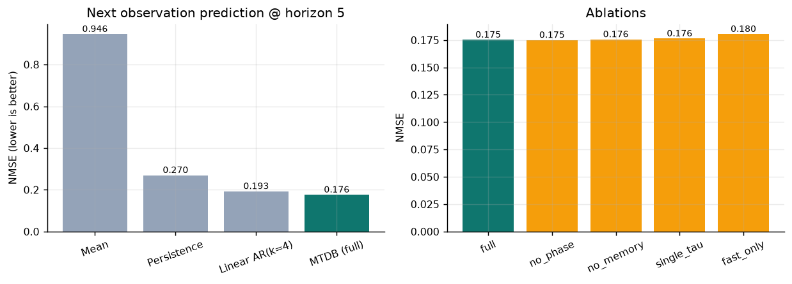
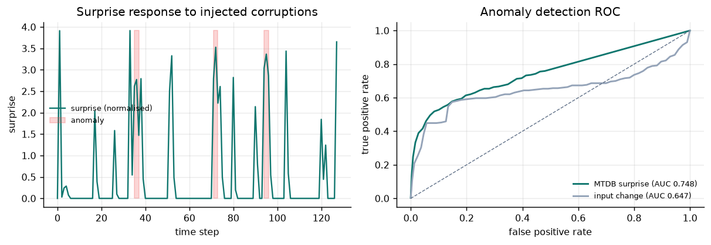
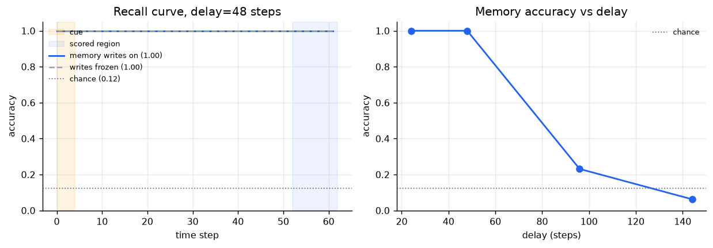
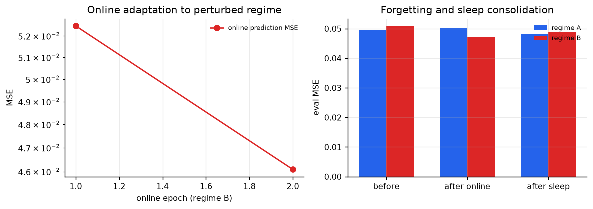

> English translation of [RESULTS.md](RESULTS.md).

# MTDB Experimental Results (v0.1.0)

**English** | [中文](RESULTS.md)

This report was generated/compiled from `results/demo_standard/results.json` (`configs/standard.yaml`),
with the command:

```bash
.venv/bin/python scripts/train.py --config configs/standard.yaml --run-name demo_standard
```


> The v0.2 active-inference benchmark (MTDB active vs Transformer baselines) is in [ACTIVE_INFERENCE.md](ACTIVE_INFERENCE.md).

---

## 1. Experimental Setup

| Item | Value |
|---|---|
| Hardware | Apple Silicon Mac (arm64), CPU (device auto → cpu) |
| Software | macOS 27.3 / Python 3.14.6 / PyTorch 2.15.0 / CPU |
| Dynamical units | N = 2048, fan-in K = 24 (about 1.2% sparse) |
| Time constants | τ = (10, 100, 1000) ms, ratio (0.5, 0.3, 0.2), dt = 10 ms |
| Phase | 12 clusters, Kuramoto coupling 0.4 |
| Memory | WM 64 slots, LTM capacity 1024, top-k=12 |
| Interface dimensions | 283 = h128 + Φ36 + WM48 + LTM48 + (s,Δs)20 + aux3 |
| Parameters | 256,896 |
| Data | synthetic 10-dimensional multimodal world: position/audio/touch/object one-hot; hidden velocity |
| Prediction target | the observation after horizon = 5 steps |
| Stage 1 | 4 epochs × 96 sequences × 128 steps |
| Stage 2 | 2 epochs × 96 regime-B sequences, RLS `forget=0.99995` |
| Sleep | 2 passes × 256 windows (quota 128 per regime), pruning 1% |
| Runtime | 237.6 s total (Stage1 27.7 s + Stage2 49.5 s + stress test 33.4 s + the rest) |

---

## 2. Prediction: Next Observation (horizon=5)



| Model | MSE (mean±std over 16 evaluation sequences) | NMSE | Relative to MTDB |
|---|---:|---:|---:|
| Mean predictor | 0.26074 ± 0.01388 | 0.946 | +437% |
| Persistence | 0.07436 ± 0.01106 | 0.270 | +53.2% |
| Linear AR(k=4) | 0.05317 ± 0.00659 | 0.193 | +9.5% |
| **MTDB (this repository)** | **0.04855 ± 0.00615** | **0.176** | — |

- **34.7%** lower than persistence, and **8.7%** lower than linear-AR(4);
- the advantage comes from the hidden velocity/context information provided by the multi-timescale state (the observation contains no velocity, only position);
- this is a small-scale synthetic task; the gap does not represent the ratio on real vision tasks.

---

## 3. Anomaly Detection: The Surprise Signal



| Score | ROC-AUC | AUC after 3-step smoothing |
|---|---:|---:|
| MTDB normalized surprise | **0.722** | 0.748 |
| Input change \|\|s(t)−s(t−1)\|\| | 0.647 | 0.745 |

- normal steps average surprise 0.408, anomalous steps average 1.864 (about 4.6×);
- anomaly types include: position teleport, audio glitch, wrong object, position freeze, audio freeze;
  the latter two deliberately weaken the "input change" baseline, so MTDB's raw AUC advantage is clear; after smoothing the two are close,
  indicating that input change itself is already strong for "teleport/glitch" anomalies, which is an honest control result;
- anomalous steps 303 / 3072 (about 9.9%), the task is on the hard side.

---

## 4. Delayed Recall: Long-Horizon Memory



8-class delayed recall; the cue is presented for only 3 steps, followed by a 48-step delay + 10-step evaluation region.  
"writes on/off" indicates whether memory writing is enabled at inference time (readout and dynamics are fully frozen).

| Delay (steps) | Writing on | Writing frozen | chance |
|---:|---:|---:|---:|
| 24 | 1.000 | 1.000 | 0.125 |
| **48 (training delay)** | **1.000** | **1.000** | 0.125 |
| 96 | **0.231** | 0.134 | 0.125 |
| 144 | 0.063 | 0.063 | 0.125 |

- accuracy within the training delay is 100%, showing that slow-timescale dynamics suffice to carry about 0.5 s of context;
- when the delay is stretched to 96 steps (≈1 s) accuracy drops sharply, but **with writing on 0.231 vs 0.134 when frozen**,
  working-memory writing starts to show its value; at 144 steps (≈1.45 s) it is already below chance, showing that the current
  memory substrate with the slowest τ=1 s has a clear temporal horizon;
- this decay curve is the expected behavior of "bottom-layer intuitive memory", and is also the motivation for adding longer τ/attractor consolidation later.

---

## 5. Online Adaptation and Sleep Consolidation



### 5.1 Main experiment: conservative forgetting (`forget=0.99995`)

| Stage | regime A MSE | regime B MSE |
|---|---:|---:|
| Before online | 0.04948 | 0.05080 |
| After online (2 epochs) | 0.05031 | **0.04730** |
| After sleep replay | **0.04805** | 0.04891 |

- online learning lowers B by 0.00349 (−6.9%); A degrades by only 0.00083 (+1.7%);
- sleep replay further restores A to 0.04805 (0.00226 lower than after online, and also lower than before online),
  showing that replay refitting is effective at "pulling the old task back";
- B regresses slightly by 0.0016 after sleep, suggesting that readout refitting involves an old/new distribution trade-off, kept by the gate within
  the range of "replay error decrease" (replay MSE 0.0543 → 0.0483).

Sleep statistics: 256 replay windows, 31,488 samples; 10 attractor prototypes;
2,048 pruned synapses; weight drift L2=10.94; noisy prototype retrieval cosine **0.818** vs random chance 0.231.

### 5.2 Forgetting stress test: aggressive forgetting (`forget=0.999`)

| Stage | regime A MSE | regime B MSE |
|---|---:|---:|
| Before online | 0.04950 | 0.05084 |
| After online (1 epoch) | **0.11474** (forgetting +0.0652, 2.3×) | 0.06761 (+33%) |
| After sleep replay | **0.04813** (recovery 0.0666, essentially back to pre-online) | **0.04902** (recovery 0.0186, back to pre-online) |

- aggressive forgetting is used to artificially create "catastrophic forgetting": A's MSE more than doubles;
- sleep replay pulls A back to 0.04813 (even slightly better than before online), and B also returns to 0.04902;
- replay MSE before refitting 0.3576 → after 0.0483, showing that the readout is indeed rebuilt on the replay distribution;
- this is the most direct evidence in this repository supporting "sleep replay alleviates catastrophic forgetting", but it also shows that **the current mechanism
  mainly completes consolidation at the readout layer**; the recurrent weights themselves only undergo pruning/renormalization, not full synapse-level replay learning.

---

## 6. Ablation (Short Budget: 96 Training Sequences × 4 Epochs, Single Seed)

| Variant | MSE | NMSE | Parameters | Relative to full |
|---|---:|---:|---:|---:|
| full | 0.04830 | 0.1752 | 256,896 | — |
| no_phase | 0.04824 | 0.1750 | 256,896 | −0.1% |
| no_memory | 0.04840 | 0.1756 | 117,632 | +0.2% (54% fewer parameters) |
| single_tau (100ms) | 0.04861 | 0.1764 | 256,896 | +0.6% |
| fast_only (10ms) | 0.04974 | 0.1805 | 256,896 | +3.0% |

**Interpretation (honest version)**:

- on the short-horizon synthetic task of "5-step prediction", the marginal contribution of the phase layer and working memory is very small;
  the significant value of the memory module is **parameter efficiency** (54% fewer parameters with no drop in performance);
- removing multi-timescale (single_tau / fast_only) consistently makes things worse, especially fast_only by 3.0%,
  showing that slow time constants are effective at integrating hidden velocity/context;
- this is consistent with the design expectation: the value of phase binding and attractor memory should show up on longer horizons, multi-object binding,
  context switching, and interference tasks, rather than in one-step/five-step prediction MSE. Future experiments should be designed for these tasks.

---

## 7. Comparison with Design Goals

| Design goal | Evidence in this repository | Status |
|---|---|---|
| Multi-timescale carrier of temporal dynamics | delayed recall decay curve; fast_only ablation gets worse | ✅ preliminary evidence |
| Sparse/low-power structure | O(N·K) sparse gather; fan-in on the order of 1% | ✅ structurally ready, power not measured |
| Local learning, no BPTT | three-factor rule + ridge/RLS readout, no backprop anywhere | ✅ runnable |
| Prediction error drives attention/writing | surprise gating; anomaly AUC 0.72 | ✅ preliminary |
| Stable long-term memory | attractor retrieval cosine 0.82 vs chance 0.23 | ✅ prototype-level |
| Sleep replay alleviates forgetting | stress test: both A/B recover to pre-online levels | ✅ preliminary |
| Reasoning/language for AGI | — | ❌ out of scope for this layer |
| Real embodied/multimodal | — | ❌ synthetic tasks only |

---

## 8. Reproduction and Artifacts

```bash
# Full experiment (about 4 minutes on CPU)
.venv/bin/python scripts/train.py --config configs/standard.yaml --run-name demo_standard

# Re-run evaluation
.venv/bin/python scripts/eval.py --checkpoint artifacts/demo_standard/checkpoint.pt
```

Artifacts:

- `results/demo_standard/results.json`: all metrics, ablations, and curve data (committed);
- `artifacts/demo_standard/checkpoint.pt`: dynamics W/W_in, memory, self-predictor, readout (generated locally, not committed);
- `assets/*.png`: the 5 figures in this report (committed);
- `results/demo_standard/config_resolved.yaml`: the actual configuration (committed).

---

## 9. Limitations and Next Steps

1. **Synthetic world**: 10-dimensional toy observations, hidden velocity, smooth dynamics; real vision/audio would be much harder.
2. **Short-horizon bias**: prediction horizon=5 weakens the causal role of phase/memory; longer-horizon,
   binding, and interference benchmarks need to be designed (multi-object swapping, occlusion, context switching).
3. **Sleep consolidation is mainly at the readout layer**: recurrent synapses only undergo pruning/renormalization, without STDP replay along trajectories;
   this is the most important next extension.
4. **The working-memory advantage appears only at long delays** (96 steps: 0.231 vs 0.134), and the absolute accuracy is not high;
   slot structure/readout mechanisms are needed (e.g. reading by slot/temporal order rather than pure content addressing).
5. **RLS stability**: numerical guardrails and Bayesian initialization have been added, but longer streams/larger interfaces still need block updates or
   a factorized implementation.
6. **No power/latency hardware measurements**; 1–3 W is a design target, not a result of this repository.
7. **Anomaly detection should use the stage-1 checkpoint**: online adaptation rewrites the self-predictor and the surprise normalization statistics,
   and anomaly AUC on the final checkpoint drops to about 0.51. This shows that "world-model calibration" inside the base
   should be decoupled from upper-layer task adaptation (e.g. freeze surprise statistics and update only the readout), which is a clear next improvement point.

For a fuller architecture description, formulas, and code mapping see [ARCHITECTURE.md](ARCHITECTURE.md).
